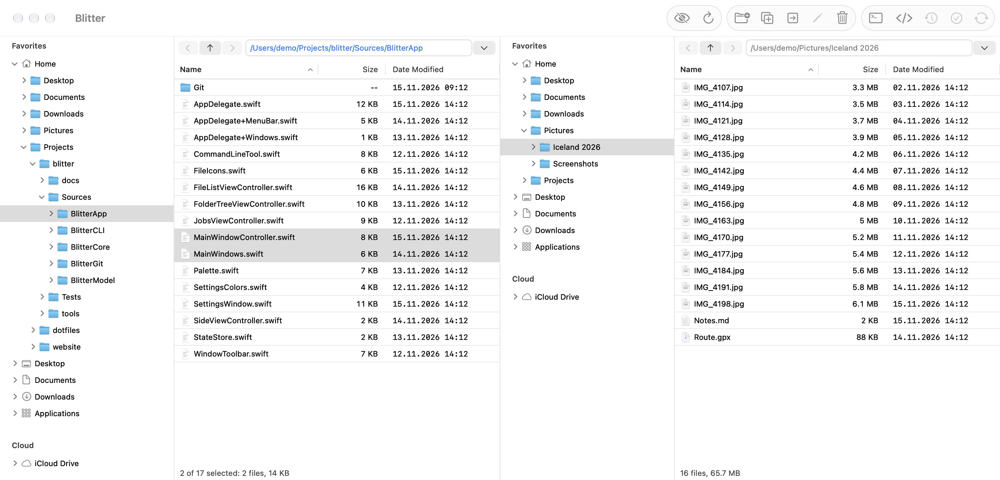

# Blitter

A fast, keyboard-driven, two-sided file manager for macOS.

<picture>
  <source media="(prefers-color-scheme: dark)" srcset="docs/manual/images/readme-dark.png">
  
</picture>

Blitter is a native macOS file manager in the tradition of Directory Opus and the Amiga: two sides next to
each other, each with a folder tree and a detailed file list. The active side is the source, the other side the
destination: copy, move and compare go from one to the other, and nearly everything is a keystroke away. The name
comes from the Amiga's Blitter chip, whose job was moving blocks of memory around very fast.

It exists because Path Finder became unusable, and nothing else on the Mac offers a fast two-sided, keyboard-driven
workflow.

## Download

**[Blitter for macOS](https://github.com/gersonkurz/blitter/releases/latest)**: open the DMG and drag Blitter to
Applications. Releases are signed with a Developer ID and notarized by Apple. Needs macOS 15 or later, on Apple
silicon or Intel.

## What it does

- **Two sides, several windows.** Each side has its own history and recent folders (⌘Y); File → New Window (⌘N)
  opens another window, and every window comes back at the next launch.
- **Fast with large folders.** Listings come straight from the kernel, nothing blocks the window, and cloud or
  network folders never stall the other side.
- **Find things.** Type to highlight names (the fast filter), select by pattern, or search names and contents
  below a folder.
- **File operations as jobs.** Copy, move, rename, batch rename and the Trash run in the background with progress
  and Cancel; Undo takes back the last one.
- **Git built in.** Working copies and their changes are colored; Log, Commit, Sync, Clone and Clean, and any change
  in your diff tool.
- **Yours to shape.** Tools, menus, shortcuts and toolbar buttons in the settings file or the Settings window;
  color schemes (Base16/Base24) for light and dark mode; fonts.
- **Mac through and through.** Quick Look, the Finder's clipboard and drag and drop, iCloud Drive and the cloud
  drives in CloudStorage, ejecting volumes.

## From the terminal, scripts and AI assistants

Blitter → **Install Command-Line Tool…** puts `blitter` on your PATH:

```
blitter .                  the active side shows the folder you are in
blitter ~/a ~/b            the left side shows ~/a, the right side ~/b
blitter --new ~/a          a new window
blitter state              both sides, as JSON
blitter mcp                an MCP server for Claude Code or Codex
```

Scripts (and a Python module) can read what each side shows, go to folders, select items and run actions. Nothing
changes files without your **Allow** in Blitter.

## The manual

**[gersonkurz.github.io/blitter](https://gersonkurz.github.io/blitter/)**: getting started, the two sides,
navigation, file operations, Find, Git, settings, tools and menus, the keyboard, automation. Its pictures are
made from Blitter itself, so they show the current version.

## Building

Blitter is Swift and AppKit, with no dependencies beyond Apple's frameworks and TOMLKit. You need Xcode and
[`just`](https://github.com/casey/just), [XcodeGen](https://github.com/yonaskolb/XcodeGen),
[xcbeautify](https://github.com/cpisciotta/xcbeautify), SwiftFormat and SwiftLint (all in Homebrew).

```
just run        # build and start the Debug app
just verify     # format and lint checks, then all tests
just            # every recipe
```

Work is coordinated in the [issues](https://github.com/gersonkurz/blitter/issues).

## License

MIT, see [LICENSE](LICENSE).
