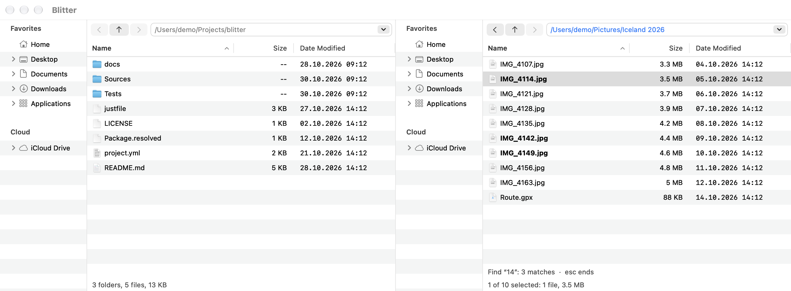

# The file list

## Columns

The list shows **Name**, **Size** and **Date Modified** to start with. Right-click the list's
header to show or hide more columns on that side:

- **Kind**: the type, e.g. "Folder" or "PDF document";
- **Permissions**: as `ls -l` shows them, e.g. `rwxr-xr-x`;
- **Git**: an item's [git status](git.md).

**Default Columns** in the same menu goes back to the columns of the settings file. Drag a
column's header to move it, and its edge to resize it; Blitter keeps both.

Folders show `--` as their size until you [measure them](file-operations.md#folder-sizes).

## Sorting

Click a column's header to sort by it, and again to reverse the order. The Git column does not
sort: the git states arrive after the listing and would reorder the rows under you. Folders
always come first. Names sort the way Finder sorts them: `File 2` before `File 10`.

## Selecting

- Click, **⇧**-click and **⌘**-click select as everywhere on the Mac; **⌘A** selects all.
- **Select by Pattern…** (**⌥⌘A**, in the Edit menu) asks for name patterns such as
  `*.jpg; *.png`. **Select** adds the matching items to the selection, **Deselect** removes
  them. Folders take part only with **Include folders**.

The status line below the list says how many items are selected and how big they are, e.g.
"2 of 15 selected: 1 folder, 1 file, 45 KB".

## The fast filter

Typing in the list finds names as you type. There is no search box to open first.

- **Type letters**: the matching names are drawn in bold and the first one is selected. A name
  matches when it contains what you typed anywhere, ignoring case and accents. The line below
  the list shows what you typed and how many names match.
- **↓** and **↑** go to the next and the previous match.
- **Start with `*`**: the list shows only the matching items. `*` stands for any number of
  characters and `?` for one, so `*jpg` lists every name that contains "jpg".
- **⌫** removes the last character; **Escape** ends the filter. Going to another folder ends it
  too.

## Hidden files

**⇧⌘.** (View → Show Hidden Files) shows or hides hidden files, on both sides.

## Keeping up to date

The list follows changes on disk by itself. **⌘R** (View → Refresh) reads the folder again
anyway.

## Zoom

**⌘+** and **⌘−** make the font of the lists and trees larger and smaller, **⌘0** goes back to
11 points. Holding **Ctrl** and turning the mouse wheel over a list or tree does the same. The
size is saved in the [settings file](settings.md#fonts-and-zoom).

## Quick Look

**Space** shows the selected items in Quick Look, as in Finder. The preview follows the
selection while it is open; **Space** again closes it.

[Back to the contents](index.md)
