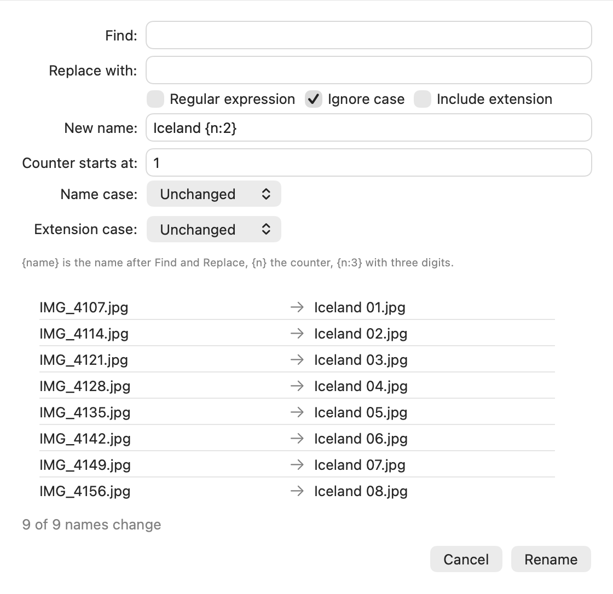
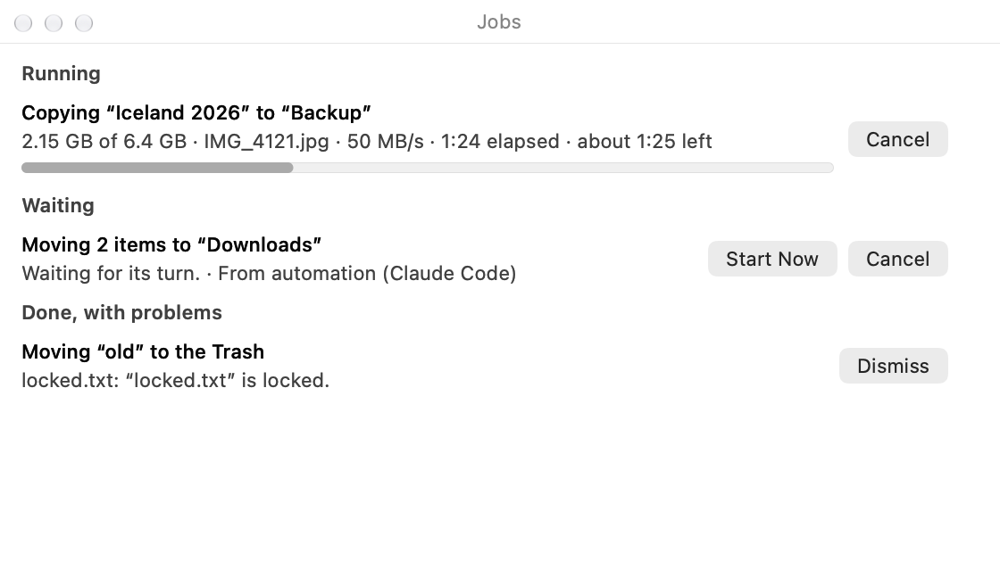

# File operations and jobs

## Copy and move between the sides

- **F5** (File → Copy to Other Side) copies the active side's selection into the other side's
  folder.
- **F6** (File → Move to Other Side) moves it there.

A copy on the same volume is a clone (APFS): it is done at once and takes no extra space until
one of the two copies changes.

## Drag and drop

Drag items between the sides, and to and from Finder and other apps.

- A drop **moves** the items, or **copies** them if Settings → Files says so (`drag_drop` in the
  [settings file](reference/settings.md)). Hold **⌥** to always copy, **⌘** to always move.
- **⇧⌘M** (View → Drag and Drop Copies) switches between moving and copying until Blitter quits,
  for every window. The menu item has a checkmark, and the toolbar's Drag and Drop Copies button
  stays pressed, while a drop copies. While you drag, the pointer shows a **+** when the drop
  will copy.
- Dropped on a folder in the list, they go into that folder; anywhere else in the list, into the
  side's folder.
- Dropping items onto the folder they are already in does nothing.

Moving (or copying, as set) applies even between volumes. That differs from Finder, which copies between
volumes. A drop onto Finder follows Finder's own rules.

## The clipboard

- **⌘C** puts the selected items on the clipboard, as Finder does.
- **⌘V** copies the items on the clipboard into the active side's folder.
- **⌥⌘V** (Edit → Move Item Here) moves them there.
- **⌥⌘C** (Copy Path) puts the selected items' full paths on the clipboard as text, one per
  line; **⌥⇧⌘C** (Copy Name) their names.

## New folder and rename

- **⇧⌘N** creates a folder named "New Folder" (or "New Folder 2"...) and lets you type its name.
- **F2** renames the selected item in place. The name is selected without its extension.
  **Return**, **Tab** or a click elsewhere keeps the new name, **Escape** keeps the old one.

## Batch Rename

**⇧F2** (File → Batch Rename…) renames all selected items at once. The list at the bottom shows
each old and new name before anything happens.

- **Find** and **Replace with** change a text in the names; with **Regular expression**,
  `Replace with` can use the groups (`$1`).
- **New name** builds the name: `{name}` is the name after Find and Replace, `{n}` a counter,
  `{n:3}` the counter with three digits. **Counter starts at** sets its first value. The items
  are counted in list order.
- The extension stays as it is unless **Include extension** is on; **Name case** and
  **Extension case** change upper and lower case.
- **Rename** starts only when every new name is possible. If one is taken by another item, used
  twice or not a valid name, the dialog says so and nothing is renamed.

## Trash and delete

- **⌘⌫** (Move to Trash) moves the selection to the Trash.
- **⌥⌘⌫** (Delete Immediately) deletes it for good, without the Trash. Blitter asks first;
  **Cancel** is the default button.
- **⌥⇧⌘⌫** (Delete Immediately Without Asking) deletes without asking. In the open File menu, it
  takes the place of Delete Immediately while **⇧** is held.

The question can be turned off: **Ask before Delete Immediately** in [Settings](settings.md).

## Folder sizes

Folders show `--` as their size. **⌥⌘S** (File → Calculate Folder Sizes) measures the selected
folders, or all folders in the list when nothing is selected. A folder shows `…` while it is
measured. Sorting by size then sorts the measured folders by their size too. The sizes stay
until the side goes to another folder.

## Compare

- **⌥⌘D** (Compare Files) shows two files side by side: two selected on one side, or one
  selected on each side.
- **⌥⇧⌘D** (Compare Folders) compares the two sides' folders.

They open in Beyond Compare if it is installed, else in FileMerge (which comes with Xcode).
[Settings](settings.md) can name another tool.

## Undo

**⌘Z** (Edit → Undo) takes back the last file operation; the menu says which, e.g. **Undo Move
to Trash**. Press it again for the one before, and so on.

| What was done | What Undo does |
|---|---|
| Copy (also a drop or Paste) | moves the copies to the Trash |
| Move (also a drop or Move Item Here) | moves the items back |
| Move to Trash, and the items a Replace sent to the Trash | puts them back where they were |
| Rename, Batch Rename | gives the old names back |
| New Folder | moves the folder to the Trash |

- Undo never deletes anything for good: what it takes away goes to the Trash.
- It never overwrites either. If something else is at an item's old place now, or the item is
  gone, Undo says so in the jobs strip and leaves that item; the rest is undone.
- Delete Immediately and tools' command lines cannot be undone.
- Blitter remembers the last 100 operations while it runs; quitting forgets them.
- While you edit a name or a path, ⌘Z undoes your typing instead.

## Jobs

Copying, moving, deleting and renaming run in the background. You can go on working meanwhile.
The strip at the bottom of the window says in one line what is going on — what runs and how far,
how many wait, a question waiting, problems — with **Show Jobs**.

The **Jobs** window shows them all, for every window: what runs, then what waits for its turn,
then what finished with problems.

- **It appears by itself** once a job has taken longer than five seconds, and at once when a
  job has a question. Quick jobs never bring it up. It does not take the keyboard from the list
  you work in. Closing it cancels nothing; **Window → Jobs** (**⌥⌘J**) shows it again. It closes
  by itself once everything is done without problems.
- **A running job** shows how far it is, how fast it goes, how long it has run and about how long
  it still needs, with **Cancel**. If it has made no progress for half a minute, it says so first
  (a big folder deleted for good can be quiet that long without being stuck). A job started by
  automation (an assistant over the `blitter` tool) says so, and so does one started in another
  window when several are open.
- **Searches and folder sizes** ([Find](find.md), Calculate Folder Sizes) are listed under Running
  too while they take a while, with how far they are and **Cancel**, which stops them as their own
  Stop does: the results so far stay. They run on their side at once and never wait for a turn.
- **A waiting job** has **Cancel**, and **Start Now** to run it beside the others — when it only
  waits because jobs take turns, never when an earlier job uses its items.
- **Quitting** with jobs not done asks first: **Quit and Cancel Them** stops them (what they
  finished stays, a file being copied is removed), or **Don't Quit**. If some have not stopped
  after ten seconds — one finishing a step it cannot break off (a batch rename), or waiting for a
  volume that does not answer — Blitter asks again: **Don't Quit** (the default) keeps it open
  while they go on stopping; **Quit Anyway** quits now and can leave files half done. Nothing
  resumes at the next launch.

- **One after the other:** copying, deleting for good, moving to another volume and undo run one
  at a time, in the order you started them; a job behind another says **Waiting for its turn.**
  Quick changes — renaming, a new folder, the Trash, moving on the same volume — and tools run at
  once.
- **Nothing overtakes:** a job never starts while an earlier one still uses its items — also
  through a link, or written in another case, and including what the earlier job will make.
  Renaming a file a waiting copy will read waits for that copy; a new folder inside the copy's
  destination does not. One exception: if an earlier job's folders do not answer for about two
  seconds (a network volume that hangs), later jobs only check the paths as you gave them, so
  one that reaches the same item another way could go first.
- **Cancel** on a waiting job takes it out at once; it has done nothing.
- A copy starts at once. One that takes longer than a few seconds has its total size measured
  beside it, and then shows how much of it is done.

- **When a name is taken**, the job asks in its row in the Jobs window: **Replace** (the existing item goes to the
  Trash), **Skip**, or **Keep Both** (the new one gets a free name such as "report 2.txt").
  **Apply to all** answers the same for the rest of the job.
- A job that finishes without problems disappears. One that had problems stays, with what went
  wrong, until you click **Dismiss**.

[Back to the contents](index.md)
