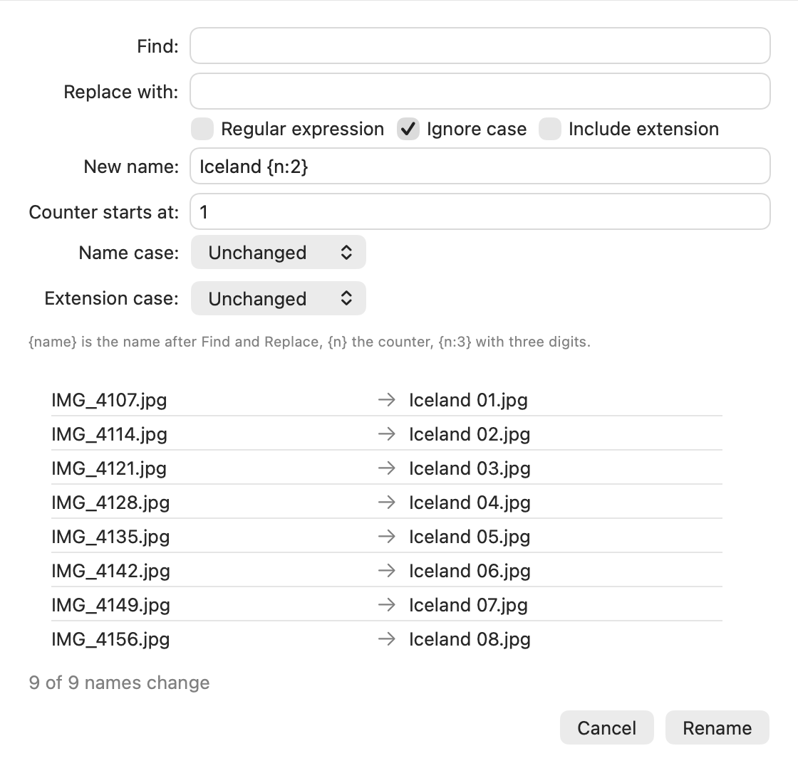

# File operations and jobs

## Copy and move between the sides

- **F5** (File → Copy to Other Side) copies the active side's selection into the other side's
  folder.
- **F6** (File → Move to Other Side) moves it there.

A copy on the same volume is a clone (APFS): it is done at once and takes no extra space until
one of the two copies changes.

## Drag and drop

Drag items between the sides, and to and from Finder and other apps.

- A drop **moves** the items. Hold **⌥** to **copy** them.
- Dropped on a folder in the list, they go into that folder; anywhere else in the list, into the
  side's folder.
- Dropping items onto the folder they are already in does nothing.

Moving is the default even between volumes. That differs from Finder, which copies between
volumes. A drop onto Finder follows Finder's own rules.

## The clipboard

- **⌘C** puts the selected items on the clipboard, as Finder does.
- **⌘V** copies the items on the clipboard into the active side's folder.
- **⌥⌘V** (Edit → Move Item Here) moves them there.
- **⌥⌘C** (Copy Path) puts the selected items' full paths on the clipboard as text, one per
  line; **⌥⇧⌘C** (Copy Name) their names.

## New folder and rename

- **⇧⌘N** creates a folder named "New Folder" (or "New Folder 2"...) and lets you type its name.
- **F2** renames the selected item in place. The name is selected without its extension.
  **Return**, **Tab** or a click elsewhere keeps the new name, **Escape** keeps the old one.

## Batch Rename

**⇧F2** (File → Batch Rename…) renames all selected items at once. The list at the bottom shows
each old and new name before anything happens.

- **Find** and **Replace with** change a text in the names; with **Regular expression**,
  `Replace with` can use the groups (`$1`).
- **New name** builds the name: `{name}` is the name after Find and Replace, `{n}` a counter,
  `{n:3}` the counter with three digits. **Counter starts at** sets its first value. The items
  are counted in list order.
- The extension stays as it is unless **Include extension** is on; **Name case** and
  **Extension case** change upper and lower case.
- **Rename** starts only when every new name is possible. If one is taken by another item, used
  twice or not a valid name, the dialog says so and nothing is renamed.

## Trash and delete

- **⌘⌫** (Move to Trash) moves the selection to the Trash.
- **⌥⌘⌫** (Delete Immediately) deletes it for good, without the Trash. Blitter asks first;
  **Cancel** is the default button.
- **⌥⇧⌘⌫** (Delete Immediately Without Asking) deletes without asking. In the open File menu, it
  takes the place of Delete Immediately while **⇧** is held.

The question can be turned off: **Ask before Delete Immediately** in [Settings](settings.md).

## Folder sizes

Folders show `--` as their size. **⌥⌘S** (File → Calculate Folder Sizes) measures the selected
folders, or all folders in the list when nothing is selected. A folder shows `…` while it is
measured. Sorting by size then sorts the measured folders by their size too. The sizes stay
until the side goes to another folder.

## Compare

- **⌥⌘D** (Compare Files) shows two files side by side: two selected on one side, or one
  selected on each side.
- **⌥⇧⌘D** (Compare Folders) compares the two sides' folders.

They open in Beyond Compare if it is installed, else in FileMerge (which comes with Xcode).
[Settings](settings.md) can name another tool.

## Undo

**⌘Z** (Edit → Undo) takes back the last file operation; the menu says which, e.g. **Undo Move
to Trash**. Press it again for the one before, and so on.

| What was done | What Undo does |
|---|---|
| Copy (also a drop or Paste) | moves the copies to the Trash |
| Move (also a drop or Move Item Here) | moves the items back |
| Move to Trash, and the items a Replace sent to the Trash | puts them back where they were |
| Rename, Batch Rename | gives the old names back |
| New Folder | moves the folder to the Trash |

- Undo never deletes anything for good: what it takes away goes to the Trash.
- It never overwrites either. If something else is at an item's old place now, or the item is
  gone, Undo says so in the jobs strip and leaves that item; the rest is undone.
- Delete Immediately and tools' command lines cannot be undone.
- Blitter remembers the last 100 operations while it runs; quitting forgets them.
- While you edit a name or a path, ⌘Z undoes your typing instead.

## Jobs

Copying, moving, deleting and renaming run in the background. Each job gets a row in the strip
at the bottom of the window, with its progress and **Cancel**. You can go on working
meanwhile.

- **When a name is taken**, the job asks in its row: **Replace** (the existing item goes to the
  Trash), **Skip**, or **Keep Both** (the new one gets a free name such as "report 2.txt").
  **Apply to all** answers the same for the rest of the job.
- A job that finishes without problems disappears. One that had problems stays, with what went
  wrong, until you click **Dismiss**.

[Back to the contents](index.md)
