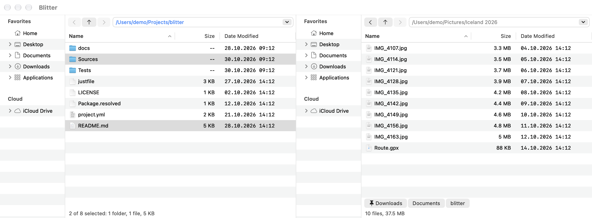

# Getting started

## Installing

Blitter runs on macOS 15 or later. Open the disk image and drag **Blitter** onto
**Applications**.

Blitter is signed but not notarized yet, so macOS stops it the first time you open it. Then go
to **System Settings → Privacy & Security** and click **Open Anyway**; after that it opens like
any other app.

Blitter is not sandboxed. To see the folders macOS protects (other apps' data, Mail, Safari),
give it Full Disk Access: **System Settings → Privacy & Security → Full Disk Access**, add
Blitter.

## The window

The window shows two [sides](sides.md) next to each other. Each side has:

- a **folder tree** on the left: your Favorites, the mounted volumes, iCloud Drive and other
  cloud drives;
- **Back**, **Up** and **Forward** buttons and a **path field** you can type into;
- the **file list** of the side's folder;
- the **recent folders** strip: the folders the side was in lately, a click away;
- a **status line**: how many items, how many selected and their size, and the free space on
  the volume.

Below the sides, the [Find panel](find.md) appears while you search, and a strip shows
[running file operations](file-operations.md#jobs) and notices, such as a problem in the
settings file.

## First steps

- Click into a side, or press **Tab**, to make it the active side. The active side's path is
  drawn in the accent color.
- **Return** or a double-click opens a folder in its side, and a file with its app.
- **⌘↑** goes to the enclosing folder, **⌘[** back, **⌘]** forward.
- **Space** shows the selection in Quick Look.
- **F5** copies the selection to the other side, **F6** moves it there.
- Type a few letters in a list to [find a name](file-list.md#the-fast-filter).
- Right-click anything for its context menu.

## What Blitter remembers

Blitter starts where you left off: each side's folder, sort order and columns, whether hidden
files are shown, and your Favorites. The window's size and position and the splitters'
positions are kept too.

Your settings are in `~/.config/blitter/settings.toml`. See [Settings](settings.md).

[Back to the contents](index.md)
