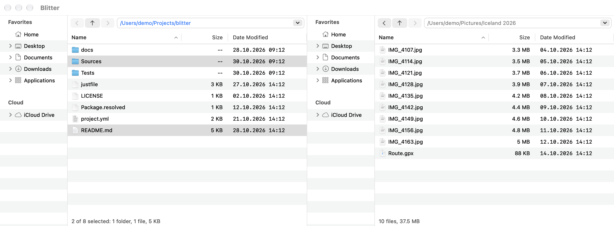

# Blitter

Blitter is a file manager for macOS in the spirit of Directory Opus: two sides next to each
other, each with a folder tree and a detailed file list, driven from the keyboard as much as
with the mouse. The active side is the source, the other side the destination: copy, move and
compare work from one to the other.

## Contents

- [Getting started](getting-started.md)
- [The two sides](sides.md)
- [Navigation](navigation.md)
- [The file list](file-list.md)
- [File operations and jobs](file-operations.md)
- [Find](find.md)
- [Git](git.md)
- [Settings](settings.md)
- [Tools and menus](tools-and-menus.md)
- [Keyboard](keyboard.md)
- [Automation](automation.md)

### Reference

These pages are generated from Blitter itself, so they always match the version they describe.

- [The settings file](reference/settings.md)
- [Actions](reference/actions.md)
- [Default menu shortcuts](reference/shortcuts.md)
