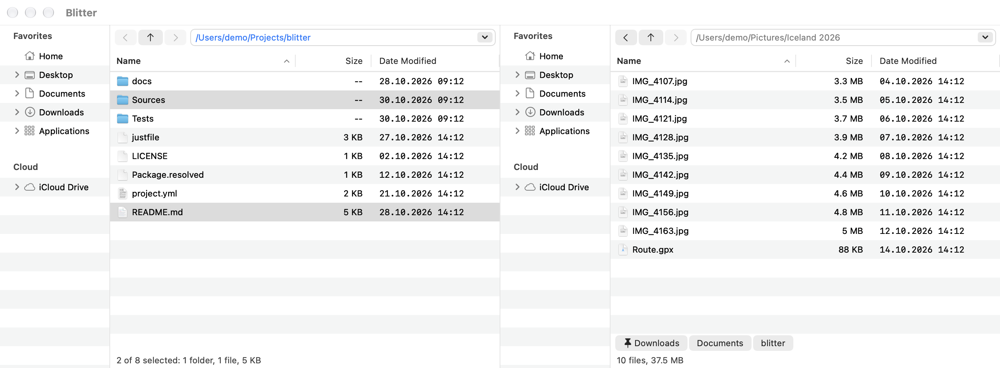

# Navigation

## Opening and going up

- **Return** or a double-click on a folder shows it in the same side. A symbolic link to a
  folder is followed.
- Files, and packages such as apps, open with their default app.
- **⌘↑** (Go → Enclosing Folder) or the **↑** button goes up one level and selects the folder
  you came from.

## Back and forward

Each side keeps its own history.

- **⌘[** or **‹** goes back, **⌘]** or **›** goes forward.
- The Go menu does the same for the active side.

## The path field

The field at the top of each side shows its folder. You can type a path into it:

- **⇧⌘G** (Go → Go to Folder…) puts the cursor in the active side's field.
- Press **Return** to go there. **Escape** drops what you typed.
- `~` is your home folder. A path without a leading `/` is taken relative to the side's folder,
  and `..` goes up, e.g. `../other`.
- The arrow at the right of the field lists the side's 20 most recent folders.
- Typing the side's own folder again reads it again.

## Recent folders

Below each file list, a strip shows the folders that side was in recently, as buttons:

- The order is by frecency: folders you go to often and lately come first. The folder the side
  shows is left out; what does not fit is left out too, the least frecent first.
- Click a folder to go there; its full path is in the tooltip.
- Right-click one to **Pin to Recent Folders**: pinned folders (with a pin) always come first, in
  the order you pinned them. **Unpin** and **Remove from Recent Folders** are there too.
- Each side has its own strip, and Blitter keeps them for the next launch.

The arrow at the right of the path field still lists the side's last 20 folders in order.

## The folder tree

The tree has three sections:

- **Favorites**: Home, Desktop, Documents, Downloads and Applications to start with.
- **Volumes**: the mounted disks, updated when one is mounted or ejected. To eject one, choose
  **Eject** in its context menu, or press **⌘E** (File → Eject) while a side shows a folder on
  it. The startup disk cannot be ejected. If something still uses the volume, Blitter shows why
  macOS refused. A settings file saved before Blitter had Eject keeps its old menus: use **Reset
  to Default** in [Tools & Menus](tools-and-menus.md#menus-in-the-settings-window) to get it.
- **Cloud**: iCloud Drive and the cloud drives in `~/Library/CloudStorage` (Dropbox, Google
  Drive, OneDrive and others).

Clicking a folder in the tree shows it in the side. The tree follows the side: going to a folder
selects it in the tree.

## Favorites

The Favorites are the folders at the top of each side's tree.

- **Go → Favorites** lists them; **⌃1** to **⌃9** go to the first nine in the active side.
- **Add to Favorites** is in the tree's context menu, and in the file list's: for the one
  selected folder, or (a right-click on empty space) the side's folder.
- On a favorite in the tree: **Move Up in Favorites**, **Move Down in Favorites**, **Remove from
  Favorites**.
- **Settings… → Favorites** shows the list to reorder, edit or add to (**Add Folder…**).

They are kept in the [settings file](settings.md) as `[favorites] folders`, with `~` for your home
folder, so they travel with your settings. A change from the tree or the file list writes only
that line; your own comments in the file stay.

The tree's context menu also offers the folder's actions (New Folder, Copy Path, Compare
Folders, the Git actions, and the tools listed for folders in the settings file); they run on
the folder you clicked. **⌃↩** opens the context menu from the keyboard.

[Back to the contents](index.md)
