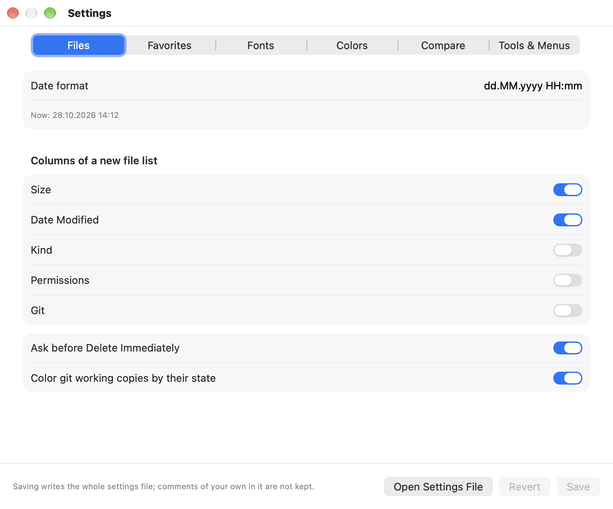
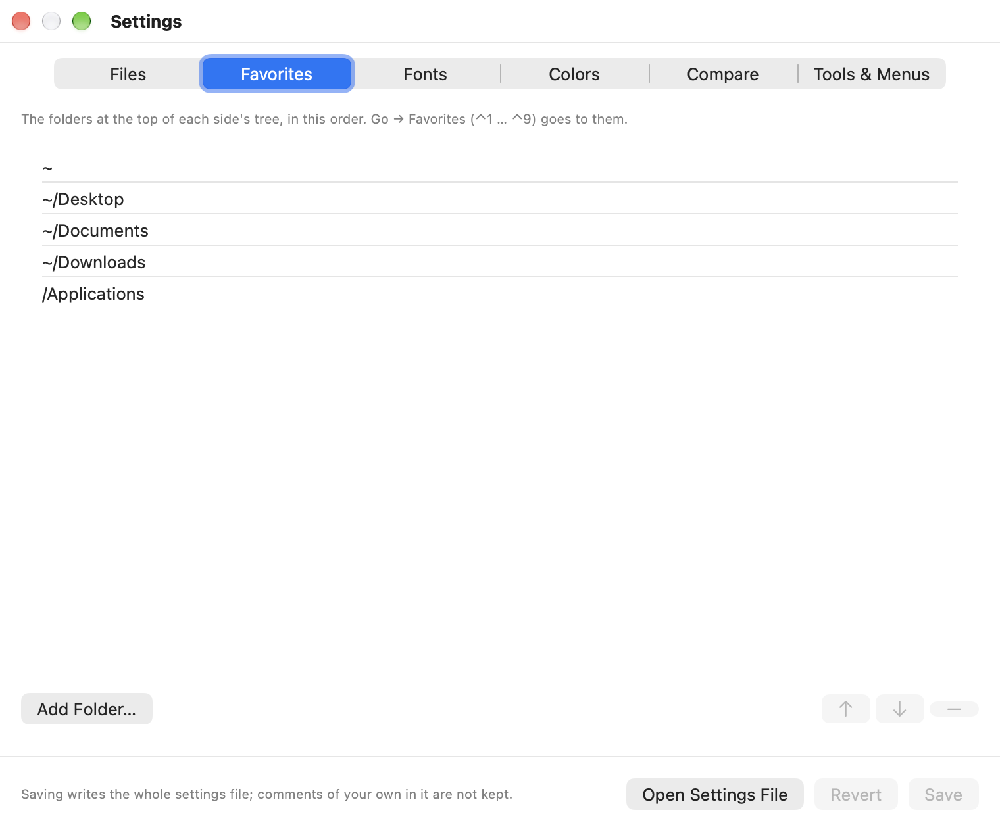
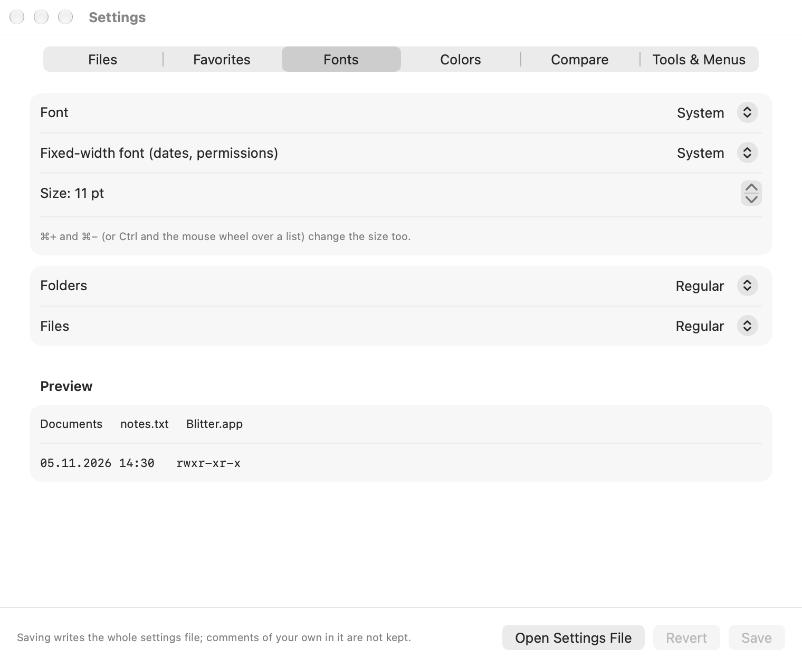
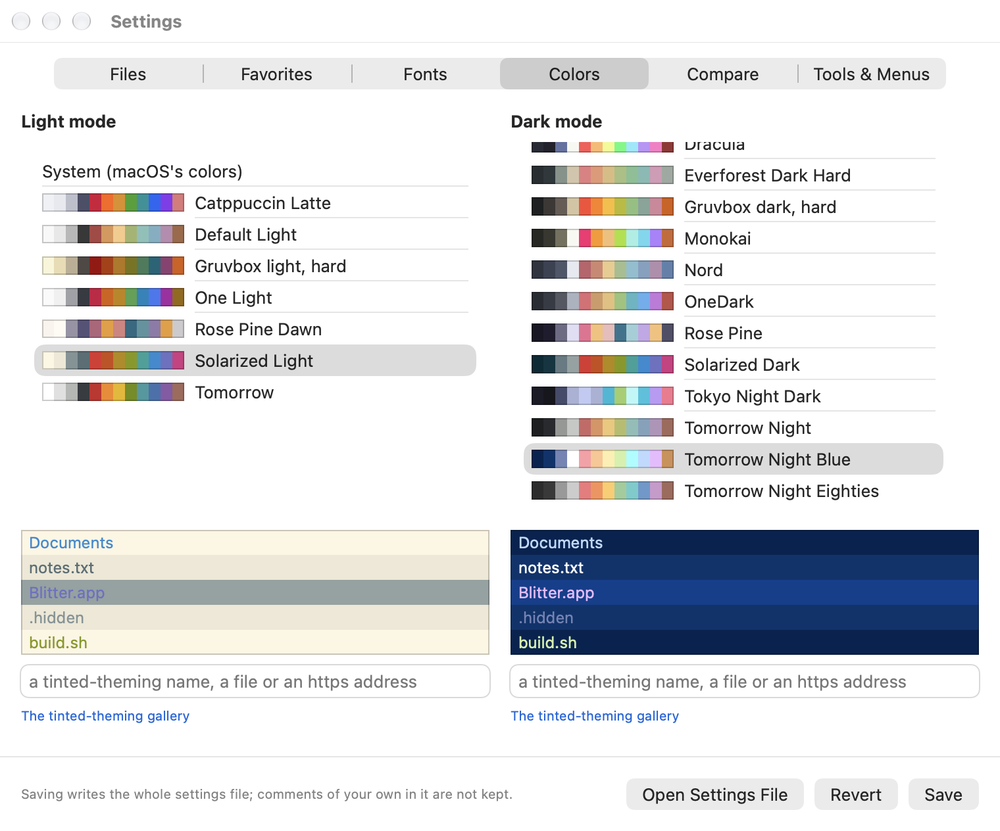
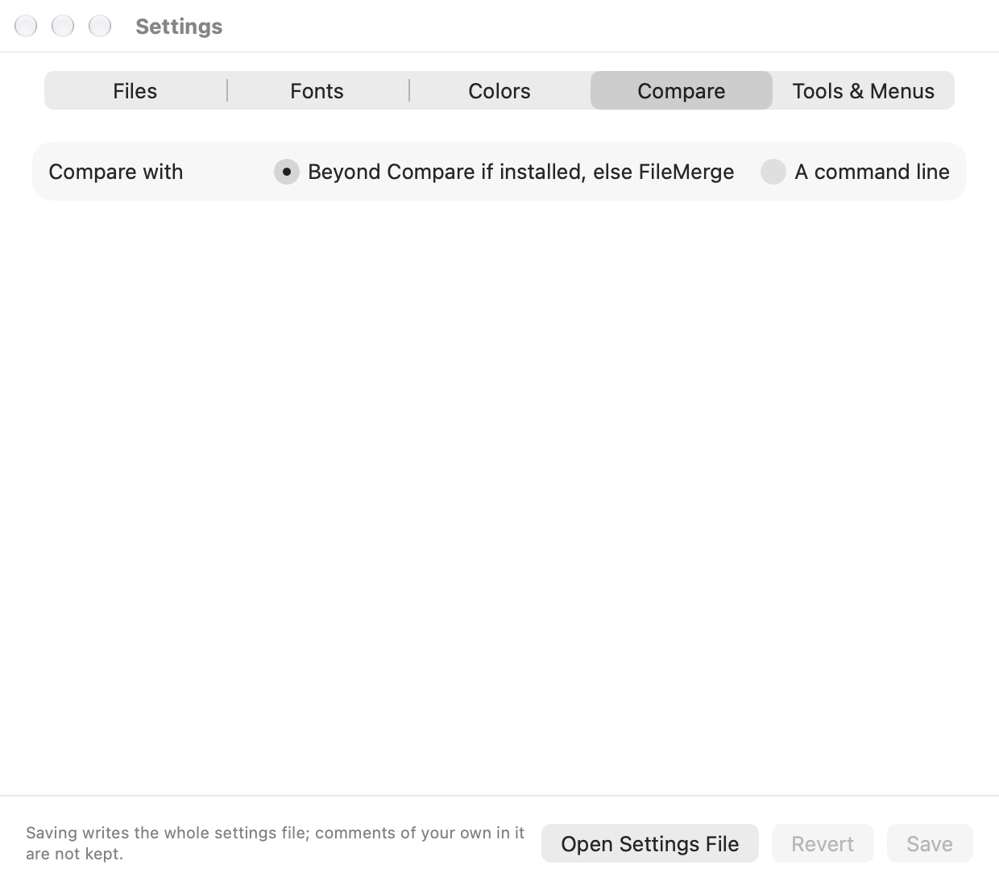
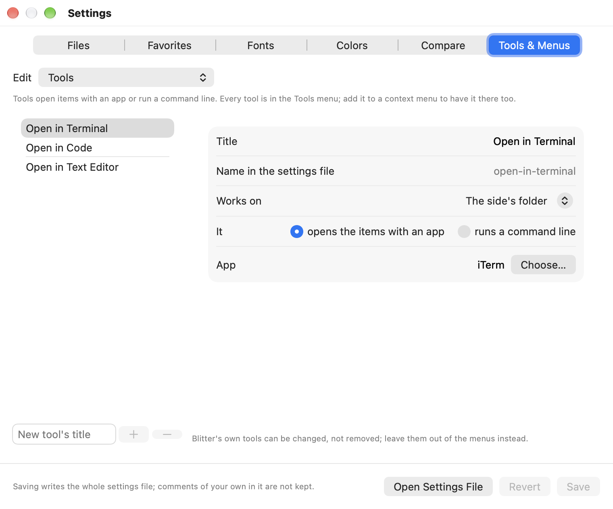

# Settings

Blitter keeps its settings in one text file, `~/.config/blitter/settings.toml`.

- **Settings…** (**⌘,**) opens a window for the common settings.
- **Open Settings File** in the window opens the file itself in the text editor tool.

Blitter reads the file at launch and again whenever it changes, so an edit takes effect as soon
as you save it. A setting that is missing or wrong falls back to its default. The problems are
listed at the bottom of the main window, each with **Dismiss**.

The [settings file reference](reference/settings.md) lists every setting with its default.

## The Settings window

Six tabs: Files, Favorites, Fonts, Colors, Compare, and Tools & Menus. Change what you like, then **Save**
(**⌘S**), or **Revert** to drop your changes.

- Saving writes the whole file anew, with Blitter's own comments. **Comments of your own in the
  file are not kept.**
- If the file changed on disk while the window was open, Save applies only what you changed in
  the window to the file as it is now.
- If the file cannot be read as a whole (it is not valid TOML), the window says so and does not
  save; fix the file in a text editor first.

### Files



- **Date format**: how the Date Modified column shows dates, as a Unicode date pattern such as
  `yyyy-MM-dd HH:mm`. **Now:** shows what it looks like.
- **Columns of a new file list**: the columns a side shows until you change its columns in the
  list's header, and what **Default Columns** goes back to.
- **Ask before Delete Immediately**: whether **⌥⌘⌫** asks first.
- **Color git working copies by their state**: see [Git](git.md).

### Favorites



The folders at the top of each side's tree, in order: **Add Folder…** adds one, a selected one
can be typed over (`~` is your home folder), moved with ↑ ↓ or removed with −. See
[Navigation](navigation.md#favorites).

### Fonts and zoom



The fonts of the file lists and folder trees; dialogs keep the system font.

- **Font**: any font family, or System.
- **Fixed-width font**: for the dates and permissions, so they line up.
- **Size**: 8 to 32 points.
- **Folders** and **Files**: the style of the names, each Regular, Bold, Italic or Bold
  Italic. The folder style is for folders in the file list and the folder tree; apps and other
  packages count as files. In the settings file they are `folder_style` and `file_style`.
  With a bold style, fast-filter matches stand out by not being bold.

**⌘+**, **⌘−** and **⌘0**, or Ctrl and the mouse wheel over a list, change the size too. Blitter
saves the new size in the file by changing only the `size` line, so your comments stay.

### Colors



Blitter takes its colors from [Base16 or Base24](https://github.com/tinted-theming/home)
schemes: one for light mode, one for dark mode. Pick each from its list; every scheme shows its
colors, and the chosen one shows a few rows of a list as Blitter will draw them. **System** keeps
macOS's own colors.

- **Built in:** 22 schemes, among them Tomorrow Night Blue, Nord, Dracula, Gruvbox, Catppuccin,
  Rosé Pine, One Dark and Solarized. The light ones come first in the light mode's list, the dark
  ones in the dark mode's.
- **Other:** type the name of any scheme of the
  [tinted-theming collection](https://tinted-theming.github.io/tinted-gallery/) (e.g.
  `gruvbox-material-dark-hard`; it is downloaded once and kept in the `schemes` folder next to the
  settings file), a scheme file (`~/themes/mine.yaml`) or an address (`https://…/mine.yaml`),
  and press Return.
- Your own scheme can be in the settings file: `[theme.schemes.<name>]` with `base00 = "#181818"`
  and so on.

Which of a scheme's colors each part of the window takes (the background, the selection, folders,
hidden items, the git states) is set in the settings file, under `[theme.roles]`.

### Compare



The tool for Compare Files and Compare Folders: Beyond Compare if it is installed, else
FileMerge; or a command line of your own, one argument per line, with `{left}` and `{right}` for
the two items. For example, for Beyond Compare's command-line tool:

```
bcomp
{left}
{right}
```

### Tools & Menus



The tools, the context menus, and the File and Edit menus' items with their shortcuts. See
[Tools and menus](tools-and-menus.md).

[Back to the contents](index.md)
