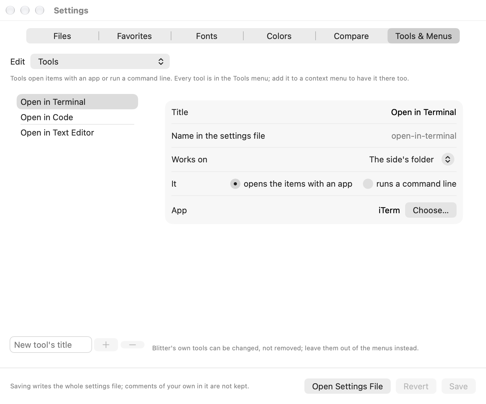
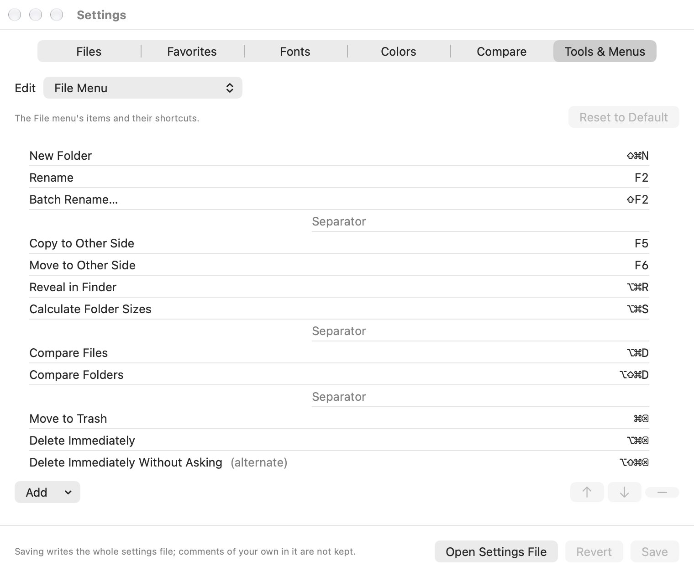
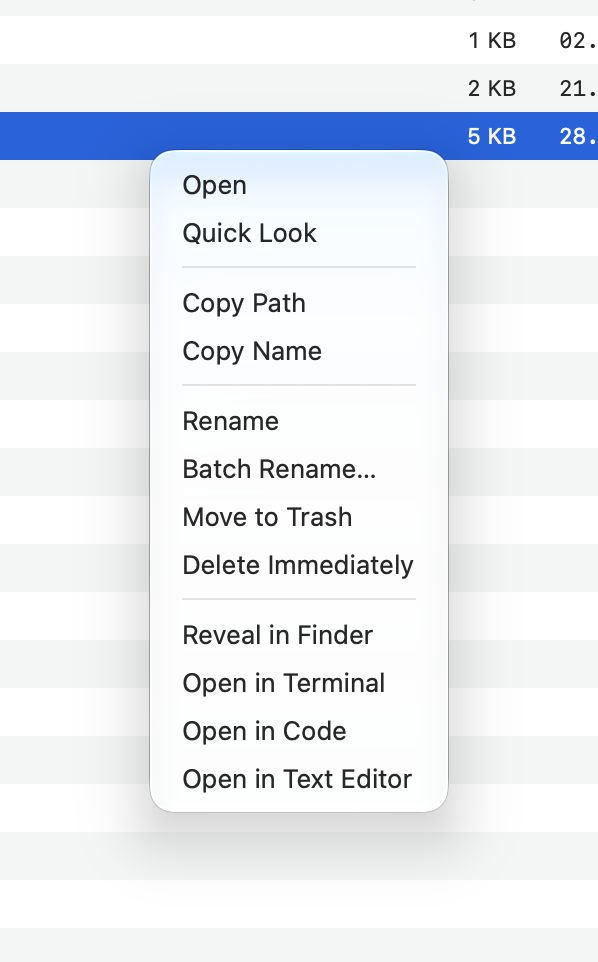
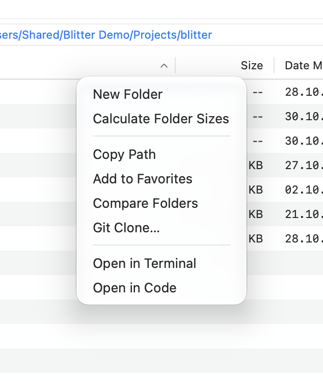
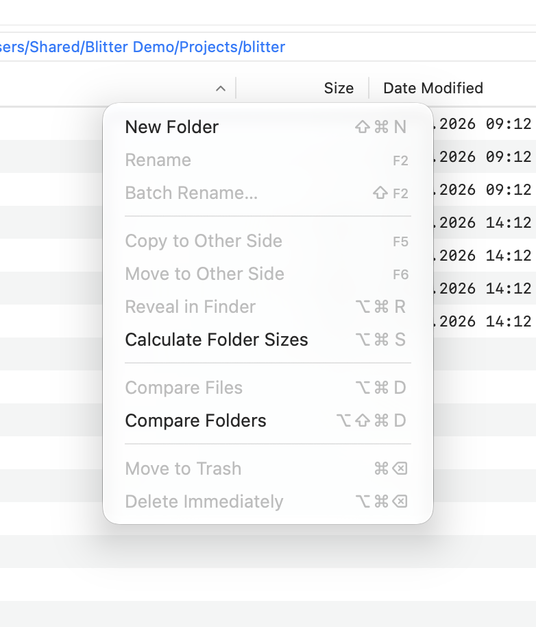
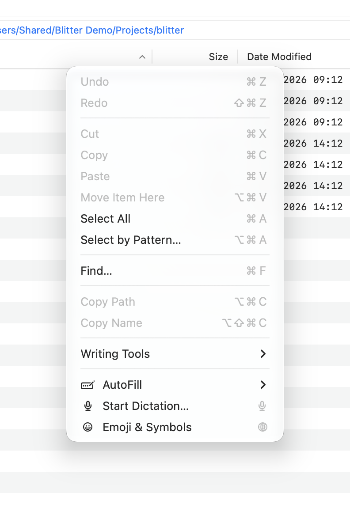

# Tools and menus

Everything Blitter does to files is an [action](reference/actions.md), with a name such as
`copy-to-other-side` or `move-to-trash`. Tools you define are actions too. The context menus and
the menu bar's File and Edit menus list actions by name, so you decide what is in them and in
what order.

Edit them in **Settings…** (**⌘,**) → **Tools & Menus**, or in the [settings file](settings.md)
itself. **Edit** at the top of the tab picks what to edit: the tools, the context menu for
items, the context menu for the folder, the File menu or the Edit menu.

## Tools in the Settings window



- Type a title under the list and click **+** to add a tool; **−** removes the selected one, and
  its entries in the menus. Blitter's own three tools can be changed, not removed.
- **Works on**: the selected items, the selected files, the selection or the folder when nothing
  is selected, or the side's folder.
- **File types**: e.g. `bin, exe`. The tool is then offered only when every selected item is
  such a file. Empty: any item.
- **It** opens the items with an **app** (type its name, or **Choose…** it), or runs a
  **command line**, one argument per line.

A new tool has no app yet; the window says so, and **Save** waits until it has one.

## Menus in the Settings window



- **Add** inserts an action (Blitter's own and your tools), a separator, or (in context menus) a
  submenu after the selected entry. **↑** and **↓** move it, **−** removes it.
- A submenu: give it a title below the list; double-click it (or **Open**) to edit its entries,
  **Back** to return.
- In the File and Edit menus, select an item to type its **Shortcut**, such as `shift+cmd+h` or
  `f7`; the list shows it as the menu will (⇧⌘H). **Alternate** shows the item in place of the
  one before it while the extra modifier key is held.
- **Reset to Default** puts the menu shown back as it comes with Blitter, replacing your
  changes to that menu. A settings file keeps the menus it had when it was saved, so actions added in a
  later version of Blitter only show up in a menu after a reset (or once you add them).
  **Revert** undoes the reset until you save.

**Save** writes the settings file. The sections below show what the same settings look like
in the file.

## In the settings file

Blitter applies a change to the file as soon as you save it. A mistake is listed at the bottom
of the window, and the rest of the file still applies.

### Tools

A tool opens items with an app, or runs a command line. Each one is a section
`[tools.<name>]`:

| Key | Meaning |
|---|---|
| `title` | the name in the menus |
| `app` | an app's name (`"Hex Fiend"`), bundle identifier or path |
| `command` | instead of `app`: a command line, e.g. `["git", "fetch"]` |
| `on` | what it acts on: `"folder"` (the side's folder), `"selection"` (the selected items), `"files"` (selected files, no folders), `"selection-or-folder"` (the selection, or the folder when nothing is selected) |
| `extensions` | only for these file types, e.g. `["bin", "exe"]`: the tool is offered only when every selected item is such a file |

Three tools come with Blitter: `open-in-terminal` (iTerm), `open-in-code` (Visual Studio Code)
and `open-in-text-editor` (TextEdit, which also opens the settings file). To change one, give
only what differs:

```toml
[tools.open-in-terminal]
app = "Terminal"
```

Every tool is in the menu bar's **Tools** menu. To have it in a context menu too, add it there.

#### Command lines

A command line runs as a job in the side's folder, with Cancel in the jobs strip. It is never
run through a shell, so `*`, `|` and `$HOME` mean nothing special.

- `{folder}` stands for the side's folder, also inside an argument.
- `{paths}`, as an argument of its own, becomes one argument per selected item.
- Programs are looked for in `/opt/homebrew/bin`, `/usr/local/bin`, `~/.local/bin`, `/usr/bin`,
  `/bin`, `/usr/sbin` and `/sbin`, or give the full path.

#### Examples

Open binaries with a hex editor, offered only for `.bin` and `.exe` files:

```toml
[tools.hex-editor]
title = "Open with Hex Editor"
app = "Hex Fiend"
on = "files"
extensions = ["bin", "exe"]
```

Compare the two items selected on one side with Beyond Compare, two folders included (this
needs Beyond Compare's command-line tool `bcomp`; the job ends when `bcomp` returns):

```toml
[tools.compare-selected]
title = "Compare with Beyond Compare"
command = ["bcomp", "{paths}"]
on = "selection"
```

To compare the two **sides'** folders, no tool is needed: **Compare Folders** (**⌥⇧⌘D**) uses
Beyond Compare when it is installed.

### Context menus

| For the selected items | For the folder |
|---|---|
|  |  |

`[context_menu]` has two lists:

- `items`: the menu for the clicked or selected items;
- `folder`: the menu for the side's folder, shown by a right-click on empty space in the list,
  and on a folder in the tree.

Each entry is an action name, `"-"` for a separator, or `{ title = "…", items = […] }` for a
submenu. A menu shows only the actions that fit what was clicked; Git Log, for example, appears
only inside a git working copy. A list replaces the default list as a whole: copy the default
from the [reference](reference/settings.md) and change it.

```toml
[context_menu]
items = [
    "open", "quick-look", "-",
    "rename", "move-to-trash", "-",
    { title = "Open With", items = ["hex-editor", "open-in-code", "open-in-text-editor"] },
    "compare-selected",
]
```

### The menu bar

| File | Edit |
|---|---|
|  |  |

`[menu_bar]` lists the File menu's items (`file`) and the items at the end of the Edit menu
(`edit`). An entry is an action name, `"-"`, or an action with a shortcut:

```toml
{ action = "copy-to-other-side", key = "f5" }
```

- Keys are written like `"shift+cmd+n"`, `"f2"` or `"opt+cmd+backspace"`; modifiers are `cmd`,
  `shift`, `opt` and `ctrl`.
- `alternate = true` shows the item in place of the one before it while its extra modifier is
  held, as Delete Immediately Without Asking does.

The [default shortcuts](reference/shortcuts.md) are those Blitter starts with.

[Back to the contents](index.md)
